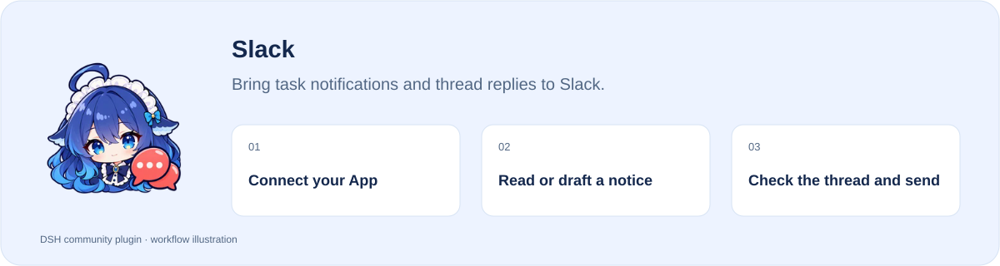

[简体中文](README.md) · **English**

# Slack

> **Bring task notifications, thread collaboration, history lookup, file sharing, and a two-way inbox straight into Slack.**

Slack integration plugin for DeepSeek Harness (`>=0.2.2-rc.3`), supporting native Markdown channel alerts, thread replies, channel & thread history reading, file uploads, emoji reactions, optional Socket Mode inbox reception, offline/online health diagnostics, and controlled backoff reconnects.

[](https://www.npmjs.com/package/dsh-slack) [](https://www.npmjs.com/package/dsh-slack) [](https://www.npmjs.com/package/dsh-slack)

**[Features](#features) · [Install](#install) · [Get Started in 3 Steps](#get-started-in-3-steps) · [Troubleshooting](#quick-troubleshooting-checklist) · [Full Guide](https://github.com/STARDUSTLC666/dsh-slack/blob/main/docs/USAGE.en.md)**

<picture>
  <source media="(prefers-color-scheme: dark) and (max-width: 640px)" srcset="https://raw.githubusercontent.com/STARDUSTLC666/dsh-slack/main/docs/assets/intro/workflow-en-mobile-dark.svg">
  <source media="(max-width: 640px)" srcset="https://raw.githubusercontent.com/STARDUSTLC666/dsh-slack/main/docs/assets/intro/workflow-en-mobile-light.svg">
  <source media="(prefers-color-scheme: dark)" srcset="https://raw.githubusercontent.com/STARDUSTLC666/dsh-slack/main/docs/assets/intro/workflow-en-dark.svg">
  
</picture>

<a id="what-it-does"></a>
## Features

| Capability | What It Gives You |
| :--- | :--- |
| **Native Markdown Alerts & Thread Replies** | Post updates via `slack_notify` / `slack_reply` using Slack Markdown blocks (with automatic plain-text fallback over 12,000 chars) |
| **Channel History & Thread Context** | Read recent channel messages (`slack_history`) and full thread discussions (`slack_thread`) with automatic `#channel` and user display-name resolution |
| **File Uploads & Emoji Reactions** | Share logs, reports, or local files with `slack_upload` (`filesUploadV2`) and acknowledge messages with `slack_react` |
| **Optional Socket Mode Inbox** | Add an `xapp-` App-Level Token to receive channel, private group, DM, `@mention`, thread, and file-share messages with automatic deduplication and self-message filtering |
| **Live Masked Settings & Online Diagnostics** | Masked tokens with prefix validation and hot reload; `slack_health` supports both offline checks and `verify=true` (`auth.test`), plus `HTTP_PROXY`/`HTTPS_PROXY` support |

## Install

Open **Plugins** in the DSH desktop app and install `dsh-slack`, or use the CLI:

```bash
dsh plugin --profile desktop add dsh-slack
```

For the web profile, replace `desktop` with `web`. Restart DSH once after installing. Requires DSH `>=0.2.2-rc.3`.

<a id="start-using-it"></a>
## Get Started in 3 Steps

1. **Create a Slack App & grab tokens**: At <https://api.slack.com/apps>, grant core scopes `chat:write` and `channels:read` (plus optional `groups:read`, `channels:history`, `files:write`, `reactions:write`, `users:read` as needed), install to your workspace, and copy the `xoxb-` Bot Token (enable Socket Mode + `xapp-` token for two-way inbox support).
2. **Save in DSH Settings**: Open **DSH Settings → Plugins → Slack (`dsh-slack`)** and enter `token` and `defaultChannel` (tokens are masked and outgoing settings apply live).
3. **Invite the bot & verify**: Run `/invite @your-bot` inside your target Slack channel, then ask the assistant to run an online health check (`slack_health` with `verify=true`) and list joined channels.

### Ready-to-copy prompts

- **Check health (with online scope verification) and joined channels**
  > Run an online Slack health check to verify my token and scopes, and list the channels (with IDs) the bot has joined.
- **Draft a channel update before posting**
  > Summarize our progress for `#engineering` and show me the draft first. Post to Slack only after I confirm.
- **Read channel history and thread context**
  > Fetch the latest 20 messages from `#engineering`, then pull the full thread discussing the release blocker and summarize it.
- **Upload a report & add a reaction**
  > Upload `report.md` to that thread in `#release` and react to the parent message with `white_check_mark`.
- **Triage Socket Mode inbox & draft thread replies**
  > Read the latest unread messages in the Slack inbox (including `@mentions` and thread replies), summarize what needs action, and draft a thread reply for my review without sending yet.

## Quick Troubleshooting Checklist

| Symptom | Likely Cause | Fix |
| :--- | :--- | :--- |
| `token 未配置` or invalid prefix | Missing `xoxb-` / `xoxp-` token, or `xapp-` pasted into `token` | Put `xoxb-` in `token` (applies live) and `xapp-` in `appToken` under **DSH Settings → Plugins → Slack** |
| `not_in_channel` / `channel_not_found` | Bot has not joined the channel, or private channel needs its ID | Run `/invite @your-bot` in Slack, then run `slack_channels` to copy the exact channel ID |
| `slack_inbox` stays empty | Missing `xapp-` token, Socket Mode off, or missing event subscriptions | Enable Socket Mode, subscribe to `message.channels` / `message.groups` / `message.im` / `message.mpim` / `app_mention`, set `appToken`, and reload |
| `invalid_auth` / `missing_scope` | Token revoked or missing required scopes (error message names exact missing scope) | Add the listed scopes in Slack App settings, click **Reinstall to Workspace**, update `token`, and verify with `slack_health(verify=true)` |

## Plugin updates

Check updates at the bottom of native plugin details. Automatic checks are on by default; **automatic installation is off**. Suite-managed components update with their bundle.

## Documentation & Feedback

- [Usage & config](https://github.com/STARDUSTLC666/dsh-slack/blob/main/docs/USAGE.en.md) · [Full reference](https://github.com/STARDUSTLC666/dsh-slack/blob/main/docs/REFERENCE.en.md) · [Release notes](https://github.com/STARDUSTLC666/dsh-slack/blob/main/CHANGELOG.md) · [Validation](https://github.com/STARDUSTLC666/dsh-slack/blob/main/docs/VALIDATION.md)
- If this plugin helps, consider starring the repo. Report bugs in [Issues](https://github.com/STARDUSTLC666/dsh-slack/issues) or open [PRs](https://github.com/STARDUSTLC666/dsh-slack/pulls) (strip credentials first).

## License

[MIT](https://github.com/STARDUSTLC666/dsh-slack/blob/main/LICENSE)

<a id="requirements-and-configuration"></a>
