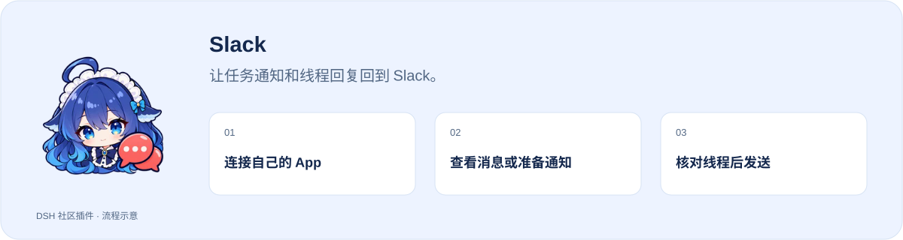

**简体中文** · [English](README.en.md)

# Slack

> **让任务通知、线程协作、历史上下文、文件分享与双向收件箱自然融入你的 Slack 工作区。**

DeepSeek Harness（`>=0.2.2-rc.3`）Slack 集成插件，支持原生 Markdown 频道发信、线程跟进、历史与线程上下文读取、文件上传、表情回应、可选 Socket Mode 双向收件箱、在线/离线连接诊断与受控退避重连。

[](https://www.npmjs.com/package/dsh-slack) [](https://www.npmjs.com/package/dsh-slack) [](https://www.npmjs.com/package/dsh-slack)

**[核心能力](#核心能力) · [安装](#安装) · [最快 3 步用起来](#最快-3-步用起来) · [常见卡点](#常见卡点自检) · [完整说明](https://github.com/STARDUSTLC666/dsh-slack/blob/main/docs/USAGE.md)**

<picture>
  <source media="(prefers-color-scheme: dark) and (max-width: 640px)" srcset="https://raw.githubusercontent.com/STARDUSTLC666/dsh-slack/main/docs/assets/intro/workflow-zh-mobile-dark.svg">
  <source media="(max-width: 640px)" srcset="https://raw.githubusercontent.com/STARDUSTLC666/dsh-slack/main/docs/assets/intro/workflow-zh-mobile-light.svg">
  <source media="(prefers-color-scheme: dark)" srcset="https://raw.githubusercontent.com/STARDUSTLC666/dsh-slack/main/docs/assets/intro/workflow-zh-dark.svg">
  
</picture>

## 核心能力

| 能力 | 说明 |
| :--- | :--- |
| **原生 Markdown 通知与线程回复** | 通过 `slack_notify` / `slack_reply` 以 Slack Markdown Block 发送进展摘要（超 12,000 字自动安全降级纯文本），并在线程内持续跟进 |
| **频道历史与线程上下文** | 通过 `slack_history` / `slack_thread` 按需回溯频道历史消息与完整线程回复，自动解析 `#频道名` 与发送者昵称 |
| **文件上传与表情回应** | 通过 `slack_upload` 上传日志/报告/本地文件（`filesUploadV2`），通过 `slack_react` 快速表态确认 |
| **可选 Socket Mode 收件箱** | 配置 `xapp-` App-Level Token 后可接收频道/私密频道/私信/`@提及`、线程回复与文件分享消息，自动去重并过滤机器人自身消息 |
| **原生设置热生效与在线自检** | 令牌自动脱敏、前缀校验与保存即生效；`slack_health` 支持离线配置检查与 `verify=true` 在线 `auth.test` 权限核验，兼容 `HTTP_PROXY`/`HTTPS_PROXY` |

## 安装

在 DSH 桌面版「插件」面板搜索安装 `dsh-slack`，或使用命令行：

```bash
dsh plugin --profile desktop add dsh-slack
```

网页版把 `desktop` 改为 `web`；安装后重启一次 DSH。宿主要求 `>=0.2.2-rc.3`。

<a id="开始使用"></a>
## 最快 3 步用起来

1. **一键创建 Slack App 拿令牌**：打开 <https://api.slack.com/apps> → **Create New App** → **From a manifest**，直接粘贴本仓库根目录的 [`slack-app-manifest.yaml`](https://github.com/STARDUSTLC666/dsh-slack/blob/main/slack-app-manifest.yaml)（已预配全量 Bot Scopes、Socket Mode、私信可写与事件订阅），安装到工作区并复制 `xoxb-` 令牌（需收件箱时在 **Basic Information → App-Level Tokens** 生成带 `connections:write` 的 `xapp-` 令牌）。手动配置见[使用说明](https://github.com/STARDUSTLC666/dsh-slack/blob/main/docs/USAGE.md#第-1-步创建-slack-app-并获取令牌)。
2. **填入原生设置**：打开 DSH「**设置 → 插件 → Slack（dsh-slack）**」填入 `token` 与 `defaultChannel`（令牌自动脱敏，发信配置保存即生效）。
3. **拉机器人进频道并自检**：在目标频道输入 `/invite @你的机器人`，回到 DSH 对话先跑一次连接自检（可加在线鉴权），即可开始发信、读历史、传文件或收件。

### 常用对话示例

- **连接自检（含在线权限验证）与已加入频道盘点**
  > 先在线检查一下 Slack 连接状态和已授予权限，并列出机器人当前已加入的频道和频道 ID。
- **发布进展通知（先审稿再发）**
  > 帮我整理刚才的任务结果，准备发到 `#engineering` 频道；先把草稿给我看一眼，我确认后再发送。
- **读取频道历史 / 线程上下文并跟进**
  > 读一下 `#engineering` 最近 20 条消息，再把讨论发布阻塞的那条线程完整上下文拉出来总结给我。
- **上传测试报告并表态确认**
  > 把这份 `report.md` 上传到 `#release` 的刚才那条线程里，并给原消息点一个 `white_check_mark` 表情。
- **汇总收件箱并起草线程回复（Socket Mode）**
  > 读取 Slack 收件箱里最新的未处理消息（含 `@提及` 和线程回复），按优先级总结，并为需要回复的那条起草线程回复，先别直接发。

## 常见卡点自检

| 遇到的现象 | 原因定位 | 解决方法 |
| :--- | :--- | :--- |
| `token 未配置` 或前缀报错 | 未填 `xoxb-` / `xoxp-` 令牌，或误把 `xapp-` 填到 `token` 栏 | 在「设置 → 插件 → Slack」把 `xoxb-` 填入 `token`、`xapp-` 填入 `appToken`（`token` 保存即生效） |
| `not_in_channel` / `channel_not_found` | 机器人未加入目标频道，或私密/重名频道需用 ID | 在频道内运行 `/invite @你的机器人`，再让助手运行 `slack_channels` 获取准确 ID |
| `slack_inbox` 一直为空 | 未配 `xapp-` 令牌、未开 Socket Mode、漏订事件或漏配 `app_mentions:read` | 推荐直接导入 `slack-app-manifest.yaml`；手动配置需开启 Socket Mode、订阅 `message.*` / `app_mention` 并补齐对应 `*:history` / `app_mentions:read` 权限，填好 `appToken` 后重载 |
| `invalid_auth` / `missing_scope` | 令牌失效或缺少所需权限（报错会直接列出缺失 scope） | 在 Slack 后台补勾报错提示的权限并 Reinstall to Workspace，然后更新 `token`，用 `slack_health(verify=true)` 复核 |

## 插件更新

在原生插件详情页底部检查更新。默认自动检查，**默认不自动安装**；是否安装、何时重启由你决定。Suite 管理的组件随整包更新。

## 文档与反馈

- [使用说明与参数参考](https://github.com/STARDUSTLC666/dsh-slack/blob/main/docs/USAGE.md) · [详细参考](https://github.com/STARDUSTLC666/dsh-slack/blob/main/docs/REFERENCE.zh.md) · [更新记录](https://github.com/STARDUSTLC666/dsh-slack/blob/main/CHANGELOG.md) · [验证范围](https://github.com/STARDUSTLC666/dsh-slack/blob/main/docs/VALIDATION.md)
- 欢迎 Star，问题与建议请提交 [Issues](https://github.com/STARDUSTLC666/dsh-slack/issues) 或 [PR](https://github.com/STARDUSTLC666/dsh-slack/pulls)（反馈前请移除凭据）。

## License

[MIT](https://github.com/STARDUSTLC666/dsh-slack/blob/main/LICENSE)

<a id="依赖与配置"></a>
